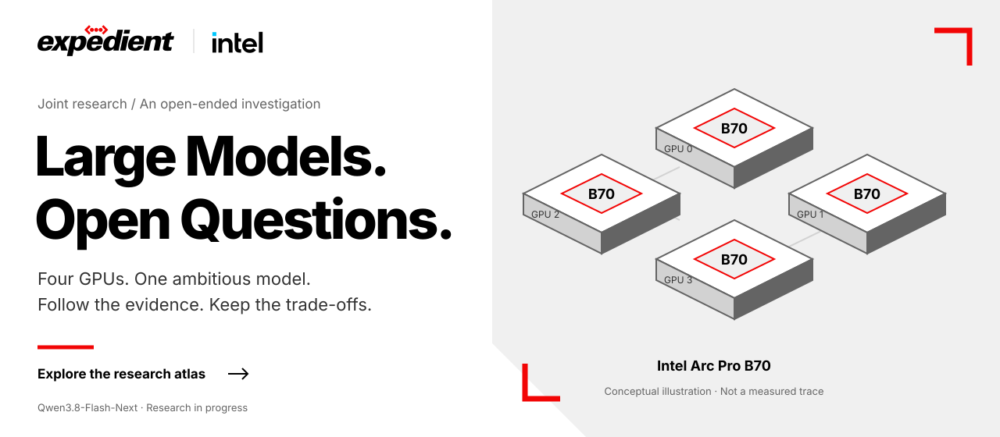

<a href="https://chad-atexpedient.github.io/expedient-intel-research-atlas/">
  
</a>

# Expedient + Intel Research Atlas

**What can four workstation GPUs teach us about large-model inference?**

We’re exploring Qwen3.8-Flash-Next on four Intel Arc Pro B70 GPUs—across memory, precision, scheduling, kernels, and the experience of one or two users. This is open-ended research. A deployable configuration is a possible outcome, not the organizing goal.

### [Explore the interactive atlas →](https://chad-atexpedient.github.io/expedient-intel-research-atlas/)

[Latest findings](https://chad-atexpedient.github.io/expedient-intel-research-atlas/#latest) · [Experiment explorer](https://chad-atexpedient.github.io/expedient-intel-research-atlas/#experiments) · [Research journal](https://chad-atexpedient.github.io/expedient-intel-research-atlas/#journal) · [Evidence & limits](https://chad-atexpedient.github.io/expedient-intel-research-atlas/#evidence)

> **A big thank-you to the Intel team for loaning the gear.** Real hardware makes it possible to test assumptions, preserve negative results, and turn interesting questions into evidence.

## Go Inside The Question

The site’s seven animated chapters explain the mechanisms behind the experiments. Choose a question, step through the work, and see where the evidence stops.

| Explore | The question behind the experiment |
|:--|:--|
| [Token routing](https://chad-atexpedient.github.io/expedient-intel-research-atlas/#experiment-routing) | Which experts do the work—and why does prefill differ from decode? |
| [GPU layout & batching](https://chad-atexpedient.github.io/expedient-intel-research-atlas/#experiment-layout) | Does distributing the weights also distribute useful execution? |
| [Weight precision](https://chad-atexpedient.github.io/expedient-intel-research-atlas/#experiment-precision) | What changes when the main weights shrink but the lookup table stays fixed? |
| [Engram residency](https://chad-atexpedient.github.io/expedient-intel-research-atlas/#experiment-engram) | Is a file-backed lookup coming from memory or storage? |
| [Long context](https://chad-atexpedient.github.io/expedient-intel-research-atlas/#experiment-context) | When does “it fits” become “it works well”? |
| [Two-user fairness](https://chad-atexpedient.github.io/expedient-intel-research-atlas/#experiment-fairness) | Can a faster average hide a worse experience for one user? |
| [Kernels & backends](https://chad-atexpedient.github.io/expedient-intel-research-atlas/#experiment-kernels) | Which execution path actually ran—and what does that prove? |

**The motion is explanatory, not telemetry.** Packet spacing, diagram counts, and animation timing are illustrative. The explorer supports manual stepping, pause, speed control, and reduced motion. GitHub shows the static cover; the interactive experience lives on the site.

## Speed Is Only Half The Story

A smaller payload can help prompt processing without materially changing generation. A higher decode number can conceal time spent waiting. A successful diagnostic can make measurement possible without making the model faster.

That is why the atlas keeps three judgments separate:

- **Measurement validity:** was the workload complete, controlled, and measured correctly?
- **Research finding:** what gain, limitation, or trade-off did it reveal?
- **Deployment eligibility:** does it meet the quality and per-user service requirements?

[Read the current findings and their caveats →](https://chad-atexpedient.github.io/expedient-intel-research-atlas/#latest)

## A Field Report, Not A Leaderboard

The journal keeps what worked **and** what failed. Each entry includes an observation, its limitations, the next question, and a source. Filters and deep links make the history browsable without turning it into a wall of numbers.

The featured [Q6/Q4 comparison](https://chad-atexpedient.github.io/expedient-intel-research-atlas/#findings) deliberately preserves its historical matched sample. Later runs do not silently replace it with a new maximum.

> **Research in progress.** Nothing here is a live hardware status, a product performance guarantee, a general model-quality endorsement, or an automatic deployment recommendation. Dates, sample counts, workload bases, and qualifications belong with the numbers.

The README is a guide, not a second benchmark report. Follow the [dated journal](https://chad-atexpedient.github.io/expedient-intel-research-atlas/#journal) and [source notes](https://chad-atexpedient.github.io/expedient-intel-research-atlas/#evidence) for the current evidence.

## Built To Stay Inspectable

Native HTML, CSS, JavaScript modules, SVG, and a curated JSON record. **No framework, runtime dependencies, account connection, or analytics.**

<details>
<summary><strong>Run the atlas locally</strong></summary>

From the repository root:

```sh
python -I -m http.server 8086 --bind 127.0.0.1
```

Open http://127.0.0.1:8086. Serve over HTTP rather than opening the HTML as a file so the browser can load `research.json`.

The core narrative, historical chart, native source disclosures, and a journal fallback remain readable without JavaScript.

</details>

<details>
<summary><strong>Run the checks</strong></summary>

Use a current Node.js release with native ES module support; Node 24 or newer is recommended.

```sh
node check.mjs
node --check app.js
node --check experiments.js
```

Checks cover measurement invariants, comparison arithmetic, malformed-data rejection, archive filtering, source/scene links, static anchors, local assets, and basic privacy guards. They do not replace evidence review or human visual review.

</details>

<details>
<summary><strong>Understand the files and update the evidence</strong></summary>

| File | Responsibility |
|:--|:--|
| [`index.html`](index.html) | Page structure, current briefing, and static fallback |
| [`research.json`](research.json) | Curated sources and dated journal entries, newest first |
| [`app.js`](app.js) | Safe text-node rendering, chart controls, compact archive, deep links |
| [`experiments.js`](experiments.js) | Conceptual SVG scenes and motion controls |
| [`styles.css`](styles.css) | Responsive Expedient presentation |
| [`assets/`](assets/) | Local brand marks, fonts, and illustrative photography |

Keep observations, sample/workload bases, limitations, and provenance together. `snapshot` is the historical numeric export; `reviewedThrough` is the latest reviewed evidence cutoff. Neither means live status.

New sources need a JSON entry, an ordering entry in `app.js`, and a static disclosure anchor in `index.html`. Update fallback copy and focused assertions with changed claims. Bump script/style version URLs only when those files change.

**Never copy entire private exports, prompts, generated responses, credentials, process identifiers, or raw logs into this repository.** The underlying research workspace and raw artifacts remain private; the site does not fetch them.

</details>

<details>
<summary><strong>How public updates ship</strong></summary>

GitHub Pages serves the root of `main` using GitHub’s built-in static publishing. No custom workflow or build dependency is required.

Run the checks and review the publication diff before pushing. Changes to `main` publish a new site version. Research work in the private workspace does **not** automatically publish here; only reviewed, explicitly promoted changes should be pushed.

The site retains `noindex, nofollow` while work continues. This is an indexing preference, **not access control**. This repository and its Pages site are public and may be copied or cached.

</details>

---

**Expedient + Intel · Research made possible through collaboration.**

Brand marks and stock imagery retain their respective rights. See [NOTICE.md](NOTICE.md) and the bundled [Inter](assets/fonts/LICENSE-inter.txt) and [JetBrains Mono](assets/fonts/LICENSE-jetbrains-mono.txt) licenses. The infrastructure photograph on the site is illustrative, not a photograph of the loaned system.

<details>
<summary>Review status and acknowledgments</summary>

The conceptual explorer’s visual storytelling was inspired by [Hugging Face’s MoE Training Handbook](https://huggingface.co/spaces/huggingface/moe-blogpost), not copied source, assets, training topology, or benchmark claims. 21st.dev catalog metadata informed the browsing direction; no component source or runtime dependency was copied.

Local content and interaction checks have passed, including responsive overflow checks. Automated screenshot capture was unavailable during the latest site visual pass. No independent visual or partner-approval sign-off is claimed.

</details>
